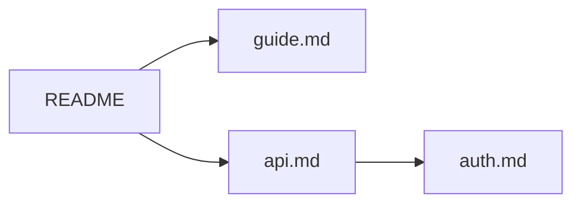

# Markdownz

A fast, lightweight **viewer** for Markdown and PDF documents, pictures, text and code, CSV tables, diagrams and Jupyter notebooks on Windows, macOS and Linux.
Double-click a `.md` or `.pdf` file, read it, press <kbd>Esc</kbd>, done.

- **Instant start.** Uses the system web view instead of bundling a browser, so installers are only a few MB.
- **Rich rendering.** GitHub-flavored Markdown plus Mermaid, KaTeX math, Graphviz, syntax highlighting, alerts, footnotes, emoji and front matter. Each extra is a plugin you can switch off.
- **PDF too.** PDFs open in the same tabs and history, with text selection, links, outline and find. Document formats are plugins, so more can follow.
- **Printing that thinks ahead.** 1, 2 or 4 pages per sheet, booklets, two-sided printing on any printer (also manually in two passes), with a preview.
- **Made for wide screens.** Show two, three or more documents side by side, or a document as printed pages with several sheets in a row. Wide tables and diagrams use the room next to the text instead of scrolling.
- **A viewer, not an editor.** Editing and advanced tools are one step away: **Open with…** hands the document to another application.
- **Tabs that come back.** Open documents are restored with their scroll position and history the next time you start the app.
- **Tree-shaped history.** Going back and following another link does not throw the old path away. **Forward** asks which branch to take, and <kbd>Ctrl</kbd>+<kbd>H</kbd> shows the whole tree.
- **Live reload.** Save the file in your editor and the view updates without losing your place.
- **Safe by default.** Scripts and event handlers in raw HTML are stripped, JavaScript in PDFs is not run, and nothing is downloaded at runtime unless you install a plugin (signed, from the Markdownz release). Links to local files Markdownz cannot show are only revealed in the file manager, never executed.

## Features

| Area | What you get |
|---|---|
| Formats | Markdown, PDF, pictures, text and code, CSV, diagram sources and Jupyter notebooks, each a format plugin that can be switched off in Settings |
| Markdown | CommonMark + GFM tables, task lists, strikethrough, autolinks, raw HTML (sanitized), GitHub-compatible heading anchors |
| Plugins | GitHub alerts (`> [!NOTE]`), footnotes, emoji shortcodes, front matter table, syntax highlighting, KaTeX math (`$…$`, `$$…$$`, fenced ```` ```math ````), Mermaid, Graphviz (```` ```dot ````) |
| PDF | [pdf.js](https://mozilla.github.io/pdf.js/): pages rendered on demand, text selection, internal and external links, outline in the table of contents, find, zoom that re-renders sharply, `#page=N` links from Markdown, printing |
| Pictures | PNG, JPEG, GIF (animated), WebP, AVIF, BMP, ICO and SVG: the whole picture fits the window at 100 %, zoom and drag to move, a checkerboard shows transparency, size and resolution in the corner; printing at the real size (the dpi stored in PNG and JPEG files, else 96 dpi; SVG by its width and height) or fitted to the paper. Scripts in SVG files do not run |
| Text and code | Plain text, logs, JSON, YAML, TOML, INI, XML, HTML source, CSS, scripts (PowerShell, batch, shell) and source code of common languages, with colours; Makefile, Dockerfile, .gitignore by name. UTF-8 or UTF-16 with a byte order mark. Nothing is ever run; files over 8 MB show their beginning |
| CSV | `.csv`, `.tsv`: comma, semicolon or tab found by itself, quoted fields with line breaks, the first row as the header, numbers aligned right; wide tables print like tables in Markdown (landscape pages, repeated header) |
| Diagram sources | Mermaid (`.mmd`) and Graphviz (`.dot`, `.gv`) files drawn as diagrams |
| Jupyter notebooks | `.ipynb` with Markdown cells, code with colours and the saved outputs (text, tables, pictures, errors); nothing is run |
| Plugins to download | More formats, installed only when you want them (Settings → Plugins, or the *Install* button shown when you open such a file): **DXF drawings** (layers, pan and zoom, print fitted to the paper), **3D models** (STL, 3MF, OBJ, PLY, glTF; turn, pan, zoom, print the current view), **TIFF** (also with several pages), **Word** `.docx` (headings, lists, tables, pictures; not the exact Word layout), **Excel** `.xlsx` (every sheet as Excel shows it: fonts, colours, borders, number formats, merged cells and column widths; formulas show their last result; no charts or pictures; printing follows the print area and title rows set in Excel). Plugins come with each release, are signed with the same key as updates and are checked again on every load; they are updated with the app and can be removed at any time. The Windows installer (MSI) has a *Plugins* page to choose them right away (silently: `msiexec /i Markdownz….msi PLUGIN_DXF=1 PLUGIN_MODEL=1 PLUGIN_TIFF=1 PLUGIN_DOCX=1 PLUGIN_XLSX=1`); they are downloaded at each user's first start. Elsewhere the first *What's new* after installing points to them |
| Navigation | Relative links to other `.md` and `.pdf` files open in the same tab; <kbd>Ctrl</kbd>+click or middle click opens a new tab; `#anchors` work across files |
| Viewing | Zoom per document, separately for the continuous view and the page view (<kbd>Ctrl</kbd>+wheel, <kbd>Ctrl</kbd>+<kbd>+</kbd>/<kbd>-</kbd>); a newly opened document starts at the zoom set in Settings (one value for each view), restored tabs keep theirs; the % button shows the zoom: a click returns to the preset, a double click to 100 %; <kbd>Ctrl</kbd>+<kbd>0</kbd> gives 100 %, and at 100 % the preset, table of contents sidebar, find in page, click a diagram to enlarge with pan and zoom, light/dark theme following the system, print or save as PDF |
| Side by side | The ▥ menu shows 2, 3 or 4 documents next to each other (up to 6 via right click on a tab → *Show side by side*); <kbd>Ctrl</kbd>+<kbd>\</kbd> toggles two. Each pane has its own document, scroll position and history; the clicked pane is the active one (toolbar, find, table of contents). Drag the divider to resize, double-click it for equal widths. Panes and widths are restored on the next start |
| Wide content | Text stays in a readable column. Tables, code blocks, math, diagrams and images that do not fit get more room, centred in the window, up to the object stop of the width ruler — like on paper: tables unwrap up to it, then everything too wide shrinks down to *Smallest table text* (print settings), then code wraps or scrolls sideways (*Still too wide*); tables and math scroll; diagrams and images scale. The **width ruler** above Markdown documents has two rows of stops: the upper one sets the text width, the lower one how wide objects may grow (drag to the window edge for "as wide as the window"); double-click a stop to reset. Both can be switched off in Settings (ruler also in the ▥ menu). Printing has its own rules, see [Printing](#printing) |
| Page view | *Pages as printed* (<kbd>Ctrl</kbd>+<kbd>Shift</kbd>+<kbd>P</kbd> or the ▥ menu) shows the document laid out with the current print settings (paper, pages per sheet, booklet, orientation, margins, scale, frames) instead of continuous text; 1–4 sheets per row or as many as fit, zoom works as usual, changes in the print dialog apply at once. Find and the outline work in the continuous view |
| Printing | Own print dialog with preview (<kbd>Ctrl</kbd>+<kbd>P</kbd> or ⎙): 1/2/4 pages per sheet, orientation by page or fixed, scale, alignment, margins, page frames, booklet (pages reordered for folding), two-sided via the printer or manually in two passes, page ranges, A4/Letter; paper is always light, Markdown is paginated between blocks |
| Recent documents | Listed on the start page and in the **+** menu with the time they were last viewed; up to 100 entries, scrollable; when a clicked document no longer exists, Markdownz says so and checks only the entries visible in that list at the moment and shows missing ones as *deleted* (struck through); they stay in the list and open again if the file comes back. The folder icon next to each entry shows the file in Explorer / the default file manager |
| Open with | Menu (<kbd>Ctrl</kbd>+<kbd>Shift</kbd>+<kbd>O</kbd>, the ↗ button or right click on a tab): the applications Windows recommends for the file type, the system "choose an application" dialog, your own applications from `config.json`, show in folder, copy path |
| Integration | `.md` and `.pdf` file associations, single instance (opening another file adds a tab), drag and drop, command line `markdownz file.md …` |

Try [`samples/demo.md`](samples/demo.md) for a tour of everything.

## Plugins and security

- **A plugin has the same rights as the app.** A plugin is JavaScript that runs in the Markdownz window, not in a sandbox: it can do whatever the app can (read files, call the app's own commands). That is why Markdownz installs only plugins from its own release, signed with the same key as updates; the signature is checked when a plugin is downloaded and again every time it is loaded, and a changed file is refused. There is no way to install plugins from anybody else. Trust a plugin as much as Markdownz itself, and do not install the ones you do not need.
- **What changed in the window's security policy (CSP).** Two additions make plugins possible: scripts may come from `mdzplugin:`, the app's own protocol that serves an installed plugin only after its signature check (`script-src`), and the window may read `blob:` addresses (`connect-src`), which plugins use to hand fonts and drawings to their libraries from memory. A `blob:` address can only be made by code already running in the window, so this opens no way to the network or to other files. Scripts in documents are still removed, and no web address was added.
- **`npm audit` in `plugins/`** reports a moderate issue in `sprintf-js` ([GHSA-hp3w-g68c-fv3c](https://github.com/advisories/GHSA-hp3w-g68c-fv3c)), pulled in by `argparse`, which the Word library `mammoth` needs only for its command-line tool. Neither is in the built Word plugin (checked in `markdownz-plugin-docx.js`); the "fix" npm offers would downgrade mammoth to a 2016 version, so it is not applied.

## Keyboard shortcuts

On macOS use <kbd>⌘</kbd> instead of <kbd>Ctrl</kbd>. Press <kbd>F1</kbd> in the app for this list; its *About* tab shows the version and the release notes, and after an install or an update the app shows once what is new.

| Keys | Action |
|---|---|
| <kbd>Esc</kbd> | Close the open dialog, find bar or diagram, otherwise close the window |
| <kbd>Ctrl</kbd>+<kbd>O</kbd> | Open file(s) |
| <kbd>Ctrl</kbd>+<kbd>W</kbd>, middle click on tab | Close tab |
| <kbd>Ctrl</kbd>+<kbd>Shift</kbd>+<kbd>T</kbd> | Reopen closed tab |
| Right click on a tab | Copy file (to paste into a folder or an e-mail; Windows and macOS), copy document path; close others, tabs to the right / left, all |
| Drag a tab | Reorder tabs |
| <kbd>Ctrl</kbd>+<kbd>Tab</kbd> / <kbd>Ctrl</kbd>+<kbd>Shift</kbd>+<kbd>Tab</kbd>, <kbd>Ctrl</kbd>+<kbd>1</kbd>…<kbd>9</kbd> | Switch tabs |
| <kbd>Alt</kbd>+<kbd>←</kbd>, mouse back | Back |
| <kbd>Alt</kbd>+<kbd>→</kbd>, mouse forward | Forward (asks when there are several branches) |
| <kbd>Ctrl</kbd>+<kbd>H</kbd> | History tree of the current tab |
| <kbd>Ctrl</kbd>+<kbd>F</kbd>, <kbd>F3</kbd>, <kbd>Shift</kbd>+<kbd>F3</kbd> | Find, next, previous |
| <kbd>Ctrl</kbd>+<kbd>B</kbd> | Toggle table of contents |
| <kbd>Ctrl</kbd>+wheel, <kbd>Ctrl</kbd>+<kbd>+</kbd> / <kbd>-</kbd> | Zoom |
| <kbd>Ctrl</kbd>+<kbd>0</kbd> | Zoom 100 %; at 100 % already, the preset zoom from Settings |
| <kbd>F5</kbd>, <kbd>Ctrl</kbd>+<kbd>R</kbd> | Reload |
| <kbd>Ctrl</kbd>+<kbd>Shift</kbd>+<kbd>O</kbd> | Open with another application |
| <kbd>Ctrl</kbd>+<kbd>P</kbd> | Print (pages per sheet, booklet, two-sided, range) |
| <kbd>Ctrl</kbd>+<kbd>\</kbd>, right click on a tab | Documents side by side (more in the ▥ menu) |
| <kbd>Ctrl</kbd>+<kbd>Alt</kbd>+<kbd>←</kbd> / <kbd>→</kbd> | Previous / next document side by side |
| <kbd>Ctrl</kbd>+<kbd>Shift</kbd>+<kbd>P</kbd>, the ▤ button | Pages as printed / continuous view |
| <kbd>Ctrl</kbd>+<kbd>,</kbd> | Settings (theme, formats, Markdown extensions) |

## Printing

<kbd>Ctrl</kbd>+<kbd>P</kbd> or the ⎙ button opens Markdownz's print dialog with a live preview of every sheet. Markdownz lays out the sheets itself and then hands them to the system print dialog, so the result is the same on every platform:

| Option | What happens |
|---|---|
| 1 / 2 / 4 pages per sheet | Pages are scaled onto portrait (1, 4) or landscape (2) sheets |
| Booklet | Pages are reordered and placed two per landscape sheet; print two-sided, fold the stack in the middle |
| Orientation | *Auto (by page)* follows the pages: a landscape page gets a landscape sheet, two landscape pages are stacked on a portrait sheet. This also applies to two-sided printing (the flip edge follows the dominant orientation). *Portrait* / *Landscape* force it (Markdown is re-paginated for the wider landscape line) |
| Two-sided (printer) | Choose *Print on both sides* in the system dialog; the hint says which edge to flip on (long for portrait sheets, short for landscape ones) |
| Two-sided, manually | For printers without duplex: front sides first, then Markdownz tells you how to put the stack back and prints the back sides; *reverse order* helps with printers that stack differently |
| Pages | `1-3, 5, 8-`; empty means all |
| Reset | Back to the defaults: 1 page per sheet, orientation and scale automatic, two-sided on the long edge, no margins, no frames |
| Placement | Scale: fit, % of the real page size, or a target page width or height in mm; horizontal and vertical alignment, margins of the physical sheet in mm (optionally also at the fold, so an A4 sheet with two pages acts as two A5 sheets), optional frames around each page and along the sheet margins |

**Text and tables** (Markdown only, in the print dialog):

| Setting | Meaning |
|---|---|
| Text size pt | Text size of the document on paper (default 10.5 pt) |
| Wide tables | *Turn the page, then shrink* (default): a page showing a table (or code, math) wider than the text turns landscape; the text keeps its width and its place on the left and continues from the previous page, so a stack bound on the left reads as one column, and the table extends to the right. A table too wide even for a landscape page then shrinks (text and size together). *Shrink only*: pages stay portrait, the table shrinks to the text width. *As is*: nothing changes, the rest is cut off |
| Smallest table text pt | Tables, code and math never shrink below this text size (default 7 pt) |
| Still too wide | *Continue below* (default): table columns that still do not fit continue in further parts of the table below, each repeating the first column; long code lines wrap. Tables with merged cells cannot be split and are cut off. *Cut off*: the rest is cut off at the page edge |
| Diagrams and pictures | They scale and are never cut: wider than the text they get a landscape page like a wide table (with *Turn the page*), and each fits within the height of its page, so it is never split between pages; a heading right above moves along |
| Repeat table headers on each page | The header rows of a table appear again on every page it continues on (default on) |
| Excel sheets | Shown when the document has Excel sheets (plugin). *Print area (when set)* (default): the print area set in Excel, otherwise the whole sheet; *Whole sheet*: always all of it, including text running on over empty cells. Either way the sheet is scaled to the page width (never split or cut off, whatever *Wide tables* says), Excel's title rows repeat on every page, and row and column headings and gridlines are printed only when the sheet prints them in Excel; *Fit to 1 page tall* shrinks it onto one page |

All of them apply to the whole document; single pages can be turned by exceptions (below). With *Orientation: Landscape* and one page per sheet every page is landscape already, so *Wide tables* is hidden and wide tables shrink.

**Turning single pages.** Exceptions belong to a block of content (a table, a paragraph), never to a page number, because pages move whenever the text or the settings change. Highest priority first:

1. **Your exception** on this computer: right-click a block (continuous view) or a page (page view) → *Landscape page* / *Portrait page* / *Automatic*. Stored in Markdownz's config for the document's full path, so it also works for read-only files. It is tied to the block by the nearest heading and a hash of the block's beginning: edits elsewhere keep it, and when the block itself changes the page view says so and offers to remove it. Exceptions of documents not opened for 180 days are dropped.
2. **A marker in the file**, an HTML comment on a line of its own (invisible on GitHub and in other viewers): `<!-- markdownz: landscape -->` or `<!-- markdownz: portrait -->` for the next block, `<!-- markdownz: landscape start -->` … `<!-- markdownz: landscape end -->` for a range, `<!-- markdownz: page break -->`. The page menu can copy a marker to paste in an editor. Markers exist only in Markdown files; CSV, code and notebooks use your exceptions.
3. **The print settings** (*Wide tables*). Whatever turns a page, a table still too wide for it shrinks down to the smallest table text and then continues below or is cut off, as set.

**Seeing and moving them.** With *Show orientation marks* (▥ menu, on by default) the continuous view and the page view show where every marker sits in the file (a label) and which blocks it affects (a bracket in the left margin), with the same buttons in both; marks are never printed and never found by Ctrl+F. Right click on a block (continuous view) or on a page (page view) opens the same menu: your exception (landscape / portrait / automatic), *Add landscape / portrait marker / page break above* the block (written into the file), copy a marker, print settings.

| Mark | Colour | Buttons |
|---|---|---|
| Marker in the file | blue | ↑ ↓ move it one block, ⟳ landscape → portrait → automatic (removes the marker; a page break above stays), ✂ page break above on/off, ✕ remove the marker (together with its page break) — Markdownz changes only those lines of the file, only while the file is unchanged since it was shown; Ctrl+Z undoes. Range markers (`start`/`end`) swap with ⇄ |
| Rule (wide content, print settings) | grey with a lock | cannot be moved itself; ⤒ turns one block earlier, ⤓ turns back one block later. This writes a *moved turn* marker such as `<!-- markdownz: landscape start · moves rule of table 13d50105 -->`, which refers to the wide block by a hash of its content and is shown in purple with a double bracket. When that block changes or is no longer wide, the marker is shown as broken or ignored and the rule applies again |
| Your exception | green | ↑ ↓ attach it to the block above or below, ⟳ landscape → portrait → automatic, ✂ page break above the block on/off (highlighted when on), ✕ |
| Page start | dotted line with *page N* (continuous view) | where a page starts with the current print settings; when it splits a block, ⤒ writes a page break marker above that block instead |
| ⟳ on page starts, page breaks and rules | | turns the page the block starts: landscape → portrait → automatic; on grey and blue labels by a marker in the file, on your page break by your exception |
| Page break marker | blue dashed line | ✂ on any label (marker, rule) writes a page break marker above that block or removes it (the button is highlighted when on); a page break marker standing alone has its own label with ↑ ↓ ✕ |
| Your page break | green dashed line | switched with ✂ on your exception's label (also for read-only files); a page break left without an exception keeps its own label with ↑ ↓ ✕ |

A label removed by a click (✕, or ⟳ back to automatic) stays a few seconds, fading, with ↺ to bring it back. For read-only files markers cannot be changed; use your exception instead.

A portrait exception keeps the block on a portrait page (wide content shrinks). When every page is landscape (*Orientation: Landscape*, one page per sheet) portrait exceptions are ignored, and the page view says so. The page view shows above the pages what is in effect, including anything overruled or ignored, and every page caption says why the page is turned; the print dialog shows the same summary. PDF pages keep their own orientation.

Markdown documents are split into pages between paragraphs, list items, table rows and code lines, never right after a heading. PDF pages are rendered at print resolution. The job sent to the printer always uses portrait paper and landscape sheets are rotated onto it, so portrait and landscape sheets can be mixed on every platform. In the system dialog keep the scale at 100 % / default.

## How the history tree works

Each tab keeps a tree of visited documents instead of a linear back/forward stack:



Say you open `guide.md` from `README`, go back, then open `api.md`. A normal browser would forget `guide.md`; Markdownz keeps both branches.
Pressing **Forward** on `README` offers a choice (the last visited branch is preselected, <kbd>1</kbd>…<kbd>9</kbd> picks directly), and the forward button in the toolbar shows the number of branches.
<kbd>Ctrl</kbd>+<kbd>H</kbd> shows the whole tree, and you can jump to any node.

## Install

Download the installer for your platform from [Releases](https://github.com/drzdez/markdownz/releases):

| OS | Package |
|---|---|
| Windows 10/11 | `.msi` or `-setup.exe` (uses the preinstalled WebView2 runtime) |
| macOS 11+ | `.dmg` (Apple Silicon and Intel builds) |
| Linux | `.flatpak`, `.deb`, `.rpm` or `.AppImage` (the non-Flatpak packages need WebKitGTK 4.1) |

Flatpak: `flatpak install --user ./Markdownz_<version>_x86_64.flatpak` (needs the Flathub remote for the GNOME runtime; see [flatpak/README.md](flatpak/README.md), which also describes publishing on Flathub). Fedora Silverblue, Kinoite and Bazzite should prefer the Flatpak; Fedora Workstation can use the `.rpm` too.

The installers register Markdownz for Markdown files (`.md`, `.markdown`, …) and PDF. Operating systems do not let an installer take over a file type silently, so confirm it once:

| OS | Make Markdownz the default for `.md` and `.pdf` |
|---|---|
| Windows | Right click a file → *Open with* → *Choose another app* → Markdownz → *Always*, or *Settings → Apps → Default apps → Markdownz* |
| macOS | *Get Info* on a file → *Open with: Markdownz* → *Change All…* |
| Linux (deb/rpm) | `xdg-mime default Markdownz.desktop text/markdown application/pdf` |
| Linux (Flatpak) | `xdg-mime default io.github.drzdez.markdownz.desktop text/markdown application/pdf`, or the file manager's *Open With* dialog |

### Open with other applications

On Windows the menu lists the applications the system recommends for the file type (as Explorer's *Open with* submenu does, e.g. Excel for `.xlsx`). **Open with…** shows the system chooser on Windows and Linux (via xdg-desktop-portal, also inside Flatpak) and an application picker on macOS. Frequently used applications can be added to the menu in `config.json` (location below):

```json
{
  "openWith": [
    { "name": "VS Code", "program": "code", "extensions": ["md"] },
    { "name": "Okular", "program": "okular", "args": ["{file}"], "extensions": ["pdf"] }
  ]
}
```

`{file}` is replaced by the document path (appended when missing); `extensions` limits the entry to some formats. On macOS use `"program": "open", "args": ["-a", "Visual Studio Code", "{file}"]`.

> [!NOTE]
> The builds are not code-signed yet. Windows SmartScreen may warn on first run ("More info → Run anyway"). On macOS, right-click the app and choose Open the first time.

## Build from source

Prerequisites ([details](https://v2.tauri.app/start/prerequisites/)):

- [Node.js](https://nodejs.org) 20+ and [Rust](https://rustup.rs) (stable)
- **Windows:** Visual Studio Build Tools with the *Desktop development with C++* workload
- **macOS:** Xcode Command Line Tools
- **Linux (Debian/Ubuntu):** `sudo apt install libwebkit2gtk-4.1-dev libappindicator3-dev librsvg2-dev patchelf build-essential`

```sh
npm install
npm run tauri dev -- -- -- "$PWD/samples/demo.md"   # hot reload; the file needs an absolute path
npm run tauri build                       # installers in src-tauri/target/release/bundle/
```

Other scripts:

| Command | Purpose |
|---|---|
| `npm test` | Unit tests (paths, links, history tree, tab operations, print imposition and pagination) |
| `npm run typecheck` | TypeScript check |
| `npm run dev` | Frontend only, in a normal browser: <http://localhost:1420/?file=/samples/demo.md> |
| `cargo test` (in `src-tauri`) | Rust tests |

Releases are built by GitHub Actions: push a tag such as `v0.1.0`, and [`release.yml`](.github/workflows/release.yml) builds all platforms into a draft release. Bump `version` in `package.json` first; the app reads its version from there.

### Updates

The app checks `https://github.com/drzdez/markdownz/releases/latest/download/latest.json` at start, at most once a day (Settings → Updates, also *Check now*), and offers to install a newer version (*Install now / Later / Skip this version*). Updates are signed: the release workflow needs the secrets `TAURI_SIGNING_PRIVATE_KEY` and `TAURI_SIGNING_PRIVATE_KEY_PASSWORD` (created with `npx tauri signer generate`); the public key is in `tauri.conf.json`. Only published releases count as "latest". Flatpak, `.deb` and `.rpm` installations are updated by their package manager, so the app only points to the download page there.

Release notes live in one place, the `<releases>` of `flatpak/io.github.drzdez.markdownz.metainfo.xml`: the app shows them (*What's new*, Help → About), and a unit test fails when the version in `package.json` has no entry there yet.

Local `npm run tauri build` also signs the updater artifacts, so set the same two variables first (or the build fails at the signing step).

## Architecture

```
src/                     frontend (TypeScript, Vite)
  app.ts                 tabs, navigation, shortcuts, session
  formats/               document format plugins: markdown.ts, pdf.ts (+ lazy pdfEngine.ts), registry.ts
  history.ts             tree-shaped history (pure, unit tested)
  links.ts, paths.ts     link classification and path resolution
  backend.ts             calls into Rust; plain-browser fallback for development
  render/renderer.ts     Markdown: markdown-it pipeline, extension registry, sanitizing
  render/plugins/        Markdown extensions (alerts, math, Mermaid, Graphviz, …)
  print/                 imposition (pages → sheets, booklet), Markdown pagination, sheet DOM
  ui/                    dialogs (incl. print dialog), find bar, TOC, diagram viewer, theme
  plugins/               downloadable plugins: contract (api.ts), install/update/load (manager.ts)
plugins/                 the downloadable plugins (DXF, 3D models, TIFF, DOCX, XLSX), built by scripts/build-plugins.mjs
src-tauri/               native shell (Rust, Tauri 2)
  src/lib.rs             file reading/watching, state files, single instance, file-open events, open with
  src/plugins.rs         downloadable plugins: download, signature check, mdzplugin: protocol
  tauri.conf.json        window, security policy (CSP), bundling, file associations
  capabilities/          what the web view is allowed to call
```

Rendering pipeline: `markdown-it` + enabled plugins → HTML → [DOMPurify](https://github.com/cure53/DOMPurify) → DOM → plugin `postRender` hooks (Mermaid and Graphviz turn placeholders into SVG) → shown.
Heavy libraries (Mermaid, Viz.js, pdf.js) load only when a document needs them. pdf.js data files (CMaps, fonts, decoders) are copied to `public/pdfjs` by `scripts/copy-pdfjs.mjs` before `dev` and `build`.

Installed plugins live in the `plugins` folder of the app data directory (on Windows the same folder as the state below).

State lives in the OS config directory (`%APPDATA%\io.github.drzdez.markdownz` on Windows, `~/Library/Application Support/io.github.drzdez.markdownz` on macOS, `~/.config/io.github.drzdez.markdownz` on Linux): `session.json` (tabs, history, zoom) and `config.json` (theme, formats, Markdown extensions, open-with applications).

### Adding a document format

A format plugin implements `FormatPlugin` ([`src/formats/types.ts`](src/formats/types.ts)) and is registered in `FORMATS` in [`src/formats/registry.ts`](src/formats/registry.ts). It claims file extensions and creates a `DocumentView` per open document; the app provides tabs, history, session, file watching, the find bar, the table of contents (from `outline()`), zoom and printing around it.

```ts
export const asciidocFormat: FormatPlugin = {
  id: "asciidoc",
  name: "AsciiDoc",
  description: ".adoc documents",
  extensions: ["adoc", "asciidoc"],
  defaultEnabled: true,
  createView: (host) => new AsciidocView(host), // load(), refresh(), setZoom(), outline(), find, ...
};
```

Also add the extensions to `fileAssociations` in `tauri.conf.json` and to `MimeType` in the Flatpak `.desktop` file.

### Writing a downloadable plugin

Formats with big libraries are plugins outside the installer: `plugins/<id>/` holds a `manifest.json` (name, description, extensions) and an `index.ts` whose default export receives the `PluginApi` ([`src/plugins/api.ts`](src/plugins/api.ts): read the file, the app's Markdown and picture views, `el`) and returns `createView(host, path)`. It also exports `api` (the `PLUGIN_API` it was built for); raise `PLUGIN_API` when the contract changes, and plugins built for another one are offered as updates instead of loaded.

```bash
npm ci --prefix plugins                   # the plugins' libraries (three.js, dxf-viewer, mammoth, …), kept out of the app
node scripts/build-plugins.mjs            # dist-plugins/markdownz-plugin-<id>.js + plugins.json
```

With `TAURI_SIGNING_PRIVATE_KEY` (and `_PASSWORD`) set, the script signs every plugin (`tauri signer sign`; the signed comment names the file) and puts the signatures into `plugins.json`. The release workflow does this and attaches the plugins and `plugins.json` to the release; the app reads `releases/download/v<its version>/plugins.json`. The Rust side downloads a plugin, checks it against the updater public key and serves it to the web view through the `mdzplugin:` protocol, checking the signature again on every load.

A new plugin also gets a checkbox on the *Plugins* page of the MSI ([`src-tauri/windows/main.wxs`](src-tauri/windows/main.wxs): a `PLUGIN_<ID>` property, its `SetProperty` and a `CheckBox`).

To try plugins before a release: build them with a throwaway key (`npx tauri signer generate`) and `--base http://127.0.0.1:8765`, serve `dist-plugins` there (`python -m http.server 8765 --directory dist-plugins`), build the app with that public key (`--config` with `plugins.updater.pubkey`), and set `"pluginIndex": "http://127.0.0.1:8765/plugins.json"` in `config.json`.

### Writing a Markdown extension

A Markdown extension is an object implementing `ViewerPlugin` ([`src/render/types.ts`](src/render/types.ts)); register it in `PLUGINS` in [`src/render/renderer.ts`](src/render/renderer.ts). It appears in Settings automatically.

```ts
export const plantumlPlugin: ViewerPlugin = {
  id: "plantuml",
  name: "PlantUML",
  description: "```plantuml blocks",
  defaultEnabled: true,
  setup: (md) => { /* optional: md.use(someMarkdownItPlugin) */ },
  fences: { plantuml: (code) => diagramSource("plantuml", code) },
  async postRender(root, ctx) { /* replace placeholders with rendered SVG */ },
};
```

## Roadmap

- PlantUML (needs Java or a server, so it would stay opt-in)
- Code signing for Windows and macOS
- More formats as plugins (HEIC, AsciiDoc, …)
- Editing stays out of scope: use **Open with…**

## License

[MIT](LICENSE)
